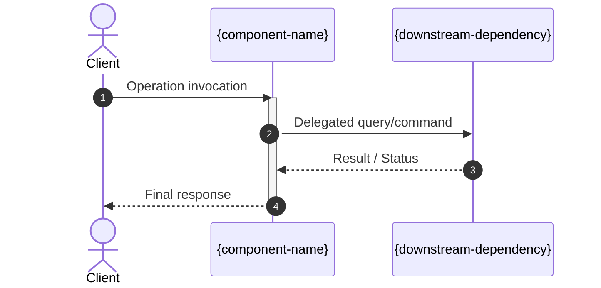

# Component Detailed Design Synthesis Prompt Template

You are a software architect and system designer. Your task is to produce a detailed structural specification for a single component grounded strictly in the boundaries established by `_adr/base.xml`.

---

## Inputs

- **Target Component ID:** {COMPONENT_ID}
- **Component Boundary Context (from `_adr/base.xml`):**
  - Scope: {COMPONENT_SCOPE}
  - Owns: {COMPONENT_OWNS}
  - Delegates: {COMPONENT_DELEGATES}
  - Depends On: {COMPONENT_DEPENDS}
  - Avoids: {COMPONENT_AVOIDS}
- **Resolved User Design Decisions:** {USER_DESIGN_DECISIONS}
- **Target Language / Syntax Preference:** {SYNTAX_PREFERENCE} (e.g., TypeScript, Go, Rust, or language-agnostic pseudocode)

---

## Design Instructions

### 1. Enforce Boundary Integrity
- Model only capabilities explicitly listed in the **Owns** field.
- Do not add features that belong to downstream systems or that violate the **Avoids** field.
- Outbound calls must map to components listed in the **Depends** or **Delegates** fields.

### 2. Pure Contract Definitions (Negative Constraint)
- Express operations and data transfers as interface declarations, type definitions, or struct shapes.
- **Do not write method implementations, function bodies, loops, or persistence logic.**
- Use the requested syntax style (or clean language-agnostic interface definitions if unspecified).

### 3. Dynamic Flow & Sequence
- Provide a Mermaid sequence diagram (`mermaid`) mapping the primary end-to-end execution path.
- Depict interactions between the caller, the target component, and downstream dependencies.

### 4. Comprehensive Error Taxonomy
- Build a structured Markdown table categorizing domain errors, protocol failures, and recovery strategies (e.g., abort, retry, fallback).

---

## Document Output Schema

Structure the generated Markdown document as follows:

```markdown
# Component Specification: {component-name} (`{component-id}`)

> **Layer:** {layer-name} (Level {level})  
> **Source ADR:** `_adr/base.xml`

## 1. Scope & Responsibility Boundaries

- **Primary Mission:** {Summary of the component's core responsibility}
- **Owned Capabilities:** {Bulleted list of capabilities owned exclusively by this component}
- **Delegated Capabilities:** {Bulleted list of tasks handed off to downstream components}
- **Strict Non-Responsibilities:** {Bulleted list of things this component must never do}

## 2. Public Contracts & Data Models

### 2.1 Core Data Structures & DTOs
```[syntax]
// Pure data models, input payloads, and result types
// No implementation code
```

### 2.2 Operational Interfaces
```[syntax]
// Public interfaces, method signatures, parameters, and return types
// Pure declarations only
```

## 3. Dynamic Execution & Interaction Flow



## 4. Invariants & State Lifecycle

- **Pre-conditions:** {Conditions that must hold true before invoking operations}
- **Post-conditions:** {System states guaranteed upon successful completion}
- **Business Invariants:** {Rules that must remain unbroken under all circumstances}
- **State Transitions (if stateful):** {Permitted state transition rules}

## 5. Failure Modes & Fault Recovery Matrix

| Failure Condition | Error Classification | Detection Mechanism | Recovery / Mitigation Strategy |
| :--- | :--- | :--- | :--- |
| Downstream timeout | Transient / System | Client timeout threshold | Retry with exponential backoff (max 3) |
| Invalid input payload | Permanent / Domain | Schema validation gate | Immediate rejection with domain error |
| Partial state failure | Invariant / Critical | Rollback / Compensating action | Revert local state and emit alert |

## 6. Verification & Testability Anchors

- **Primary Success Assertion:** {What observable outcome confirms the happy path worked}
- **Critical Edge Assertions:** {Specific failure scenarios to verify via regression tests or TDD}
- **Isolation Strategy:** {How downstream dependencies should be decoupled or mocked during testing}
```

---

## Output Delivery Format

1. Deliver the completed component design document conforming to the schema above.
2. Ensure all code blocks contain pure interface/type declarations without method bodies.
3. Keep descriptions concrete, concise, and focused on behavioral boundaries.